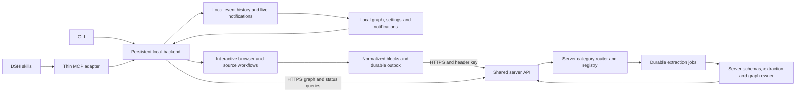

# Architecture and Demo Scope

Updated: 2026-11-15
Status: Initial implementation available; customer/provider acceptance remains pending.

The customer demo targets the week of 2026-11-16. See the
[delivery plan](development-plan.md), [dashboard specification](dashboard-demo.md),
and [technical baseline](reference-baseline.md).

## 1. Confirmed decisions and release scope

- Retain separate server and independently deployed clients. Clients acquire
  original material, clean it, create blocks, and submit over HTTPS.
- Relevance, domain extraction algorithms, domain schemas, graph storage, and
  shared-data queries belong on the server.
- Customers share data within a channel. Configuration, credentials, browser
  sessions, and private run handles remain isolated.
- The server's first deployment includes active `policy` and `economy` channels,
  each bound to its existing domain schema. New channels use a simple, predefined
  generic schema. The server categorizes submissions and creates a channel when
  none fits; clients need not select or create one before submitting content.
- Ingestion must never add entity types or relation predicates to a schema.
  Schema evolution follows periodic evidence review and administrator-controlled
  revision, validation and activation.
- Issue expiring customer keys, supplied in a header. All client-to-server requests
  use HTTPS with certificate verification.
- Graph extraction runs continuously in the background by default, with an
  environment-configured common daily batch window as an alternative.
- The persistent client backend offers CLI/MCP, interactive Camoufox, general
  acquisition, programmable source workflows, and basic source monitoring.
- The demo must include a local graph viewer, settings, and notifications dashboard.
- DSH is the first agent integration, with management/query skills. Other platform
  directories remain README-only placeholders.
- Hunters, scheduled topnews/weeklyreport generation/delivery, and intelligent
  curation CLI are deferred beyond this demo. They remain product roadmap items.
- Exclude QAnything. Any Jev use is optional client-side decision assistance, with
  configurable enablement, endpoint, and key; it must not block the demo.
- Repository documentation must not disclose internal reference repository names
  or filesystem paths.

## 2. Demo runtime and boundaries



The backend owns browser sessions, acquisition runs, basic monitoring intervals,
submission retries, and local events. Closing the UI or agent does not stop it.
CLI/MCP invocations connect to the service without spawning competing schedulers
or browser owners. Long operations return run IDs and explicit status/resume APIs.

| Component | Recommended demo baseline |
|---|---|
| Server/backend | Python 3.12+, FastAPI, Pydantic, HTTPX |
| Browser | Current managed TypeScript/Camoufox runtime, paired assets and leases |
| Node | Pinned Node 24 satisfying the selected DSH/browser requirements |
| Server metadata/jobs | SQLite WAL, migrations, durable uniqueness and transactional claims |
| Graph | Oxigraph, one designated owner, bounded asynchronous extraction |
| Client state | Separate SQLite for settings, runs, outbox, monitoring and events |
| Dashboard | Static HTML/CSS/JavaScript, local ECharts, served by the backend |
| Agent interface | Thin stdio MCP adapter and JSON-capable CLI |

One server process coordinates the embedded stores. Graph work runs away from the
API event loop. Do not run competing Uvicorn processes against one graph store.
PostgreSQL/process separation is a capacity-driven follow-up, not a prerequisite
for demonstrating two clients. Use a separate OSBI browser state directory.

The server never opens client databases or imports client implementation modules.
Clients never import domain schemas or extraction code. `contracts/` can contain
transport models and error codes, without domain extraction schemas.

## 3. Automatic server-side channels

The registry owns stable channel IDs, titles/aliases, semantic scopes, shared-data
namespaces, active schema revisions, and classification versions. Seed `policy`
for policy/regulatory/governance material and `economy` for economic, enterprise,
industry and business developments, using their existing domain schemas from the
first startup. Preserve the existing classes, predicates, hierarchy, labels,
domain/range rules and required controlled tags. Do not replace either domain
schema with the generic schema or redesign it for the demo. Verify that both
channels are enabled and queryable before the service becomes ready.

Submit through `POST /v1/materials`. Optional `channelHint` is advisory; the server
uses original title, blocks, context and eligible channels to assign coherent
source items/block groups. Search listings remain discovery material rather than
unrelated articles concatenated as one document.

```text
validate authentication and original material
  -> load eligible shared channels
  -> judge whether any existing channel fits
  -> match one OR derive a meaningful new category
  -> atomically reuse/create a registry entry
  -> bind a validated server-owned schema revision
  -> persist channel assignments and enqueue extraction
```

The no-match judgment is separate from choosing the closest existing label.
Otherwise, every topic would be forced into the two seeds. Semantic novelty can
create a channel automatically; uncertainty, incomplete input, or provider failure
alone cannot. Unresolved routing remains pending/retryable with diagnostics.

Before creation, check semantic equivalents/aliases and use a normalized category
key plus a transactional registry claim. Recheck after concurrent registry changes.
Concurrent submissions of one novel topic create one channel. Persist classifier
revision, registry version, source evidence and assignments. Source text cannot
instruct the router to change its rules. Clients discover channels through the API;
no client schema/channel configuration edit is necessary.

### Schema binding and periodic calibration

Automatic channel creation binds an existing, administrator-published generic
schema revision; it never generates or extends a schema. Start with a small common
set of entity types and relation predicates, defined before ingestion. Entity
instances and relationship assertions may be added as data under that vocabulary;
entity types and predicates cannot be added by a client, classifier, extractor,
model suggestion, or a low-confidence fallback.

The two initial channels are exceptions to generic binding: `policy` always starts
with the existing policy schema, and `economy` with the existing economy schema.
The generic schema applies to newly created channels without a dedicated schema.
Pin an immutable schema revision for each extraction job and graph receipt.

An out-of-schema type/predicate does not become an unrestricted graph fact.
Validate against the active vocabulary and domain/range rules, retain original
evidence, and record rejected assertions with reasons and source references.
Return partial/quality diagnostics where appropriate rather than silently
inventing new schema elements or losing the evidence needed for later review.

Periodic calibration applies to generic and domain schemas alike. Review actual
class/predicate usage, unresolved or rejected assertions, domain/range rejection
patterns, ambiguity, and representative original blocks. Low usage alone does not
justify deletion. Models may suggest a revision, but an administrator decides the
changes; elapsed time or accumulating data never activates one automatically.

The lifecycle is: collect diagnostics -> review evidence -> edit a new immutable
schema revision -> validate it on a fixed sample -> explicitly activate it ->
selectively re-extract affected originals. Preserve the previous schema/results
for comparison and rollback; a failed revision leaves the last valid result active.
Updating the generic revision must not silently rebind every existing channel.

For the demo, preserve the evidence, revision identifiers and diagnostic statistics
needed for manual review, plus validated configuration-based schema activation.
No automated schema-review schedule or intelligent curation CLI is required yet.
The later CLI improves this workflow; it is not a prerequisite for having a
reviewable, controlled schema lifecycle now.

New channel visibility follows service grants: keys permitted to read the shared
network discover new shared channels, while restricted keys gain no access from
client hints. Customer configuration and job handles are not shared just because
channel evidence is shared.

## 4. Material, deduplication, and durable graph work

Define a versioned material contract with source URLs/item ID, title, author and
publisher, publication/acquisition times, ordered block/segment IDs, candidate
links, capture status, and normalizer version. Return job handles, channel/schema
assignments, current-request selections, stage statuses, revision and provenance.

Keep distinct identities for request retries, routing, relevance/info, and graph
extraction. Include actual semantic inputs, sharing scope, source context, stage
revision and applicable channel/schema versions. Routing caches must account for
new channels. Date-sensitive decisions include effective time policy/expiry.

Recompute server hashes and use durable uniqueness/claims. Identical pending work
shares canonical execution; compatible completed work short-circuits model calls.
Reused selections map to the requesting client's IDs. Preserve every distinct
source observation even when body text matches. Never replay another page's link
IDs or leak private focuses/job handles via cache shortcuts.

Persist acceptance before acknowledgement. Separate pending/running/retry,
completed/empty/irrelevant, partial and failed states; recover expired leases after
restart. Preserve selected original evidence even if info fails. Graph extraction
reads original blocks, not summaries. Queries return source evidence and publication
time separately from processing time; ambiguity is not a confirmed identity.

SQLite and graph writes are not one transaction: persist write intent, commit an
idempotent graph result/receipt, then finalize SQL work. Reconcile on restart and
publish only complete active graph results. Do not claim exactly-once external
model calls across a crash, but do require one active committed graph per work ID.

## 5. Continuous/default and configured batch processing

Proposed environment contract:

```dotenv
OSBI_GRAPH_PROCESSING_MODE=continuous
OSBI_GRAPH_BATCH_WINDOW=02:00-06:00
OSBI_GRAPH_BATCH_TIMEZONE=Asia/Shanghai
```

- `continuous` consumes graph jobs whenever capacity permits; the window is ignored.
- `batch` only admits graph work inside the common daily window, including a
  cross-midnight value such as `22:00-03:00`.
- Material acceptance, category assignment, durable queuing, and queries remain
  available outside that window. Only graph model processing is delayed.
- At window close, stop claiming new work, allow bounded admitted work to finish,
  and keep the remaining backlog. Restarting inside the window resumes it.
- Validate mode, HH:MM bounds and IANA timezone at startup. A restart can apply
  environment changes; a scheduling UI is not required for the demo.
- Status APIs/viewer show mode, next eligible window, pending count and completed
  watermark. Waiting for a window is not a failure.

This mode is independent of deferred client report scheduling. Per-channel
calendars are a later option; the requested switch is common to the server.

## 6. Authentication and local access

Use opaque high-entropy keys in `Authorization: Bearer <key>`, storing verifiable
hashes, owner, expiry, revocation, scopes/grants and limits. Keep minimal key
issuance/renewal/revocation commands even though intelligent curation is deferred.
Authorize submission, polling, channel discovery, queries and provenance before
cache access. Expired/revoked keys fail on reads as well as writes.

Terminate TLS at a maintained reverse proxy with no public plaintext bypass.
Clients reject HTTP server URLs and validate certificates. The local dashboard
uses same-origin local APIs and a protected local session; the backend adds the
customer key to outbound HTTPS requests. Keys never appear in frontend bundles,
query URLs, browser storage, readback or logs. Settings return masked metadata and
accept explicit secret replacement. Apply origin checks to local writes.

## 7. Acquisition, workflows and DSH

Retain general website/RSS acquisition, domain concurrency/cooldown, URL budgets,
successful-only caching, durable outbox and server-selected-link recursion. Adapt
ARIA/DOM evidence, ordering, metadata, links/tables and coarse grouping to the
current managed browser instead of retaining a second driver.

Provide navigate/click/fill/select/wait/scroll and relevant tab/frame capture in a
minimal programmable workflow. Capture the current result page after interaction;
reopening its URL may lose state. Bound execution, keep run checkpoints and typed
parameters, and defer a rich visual editor/advanced workflow authoring suite.

Manual login/verification enters `waiting_for_user` with session, tab, lease and
prompt/run IDs preserved. Resume validates state; unknown action outcomes are
never blindly replayed. Failed, blocked, truncated or incomplete capture is not
successful empty material. Advance monitoring cursors only after artifacts/outbox
intents are durable; expired keys pause submissions rather than hammering retries.

Basic source monitoring remains from the original requirement: one persisted
interval/next-run record per source, with duplicate-run prevention after restart.
The demo does not include general calendar design or report schedules.

`osbi-manage` configures sources/workflows and handles human waits; `osbi-query`
discovers channels, disambiguates and queries evidence. Both use CLI/MCP operations.
The stdio adapter has no service-launch side effects during DSH startup probes.
Closing DSH never owns the lifecycle of the acquisition/browser backend.

## 8. Mandatory local dashboard

1. **Graph:** channels, entity search, relationships/paths, original evidence,
   revision, pending work and continuous/batch progress.
2. **Settings:** server URL/key, sources/focus/simple interval, supported workflow
   parameters and browser limits, saved locally through real backend operations.
3. **Notifications:** historical/live task and server-job events, errors/warnings,
   connection state and human-action prompts with validated resume/cancel.

Reuse established viewer/configuration/message interactions only. Serve assets
locally without cloud account, billing, phone login or hosted frontend dependencies.
Notifications are application events; no outgoing chat/report connector is needed.
See [dashboard details](dashboard-demo.md) for states and acceptance.

## 9. Optional Jev research and placement

TypeSafe's Jev answers typed questions over supplied state. Official primitives
include Choice, Score and Noul; code uses returned values/probabilities to act.
See the [official introduction](https://docs.typesafe.ai/introduction) and
[Choice reference](https://docs.typesafe.ai/primitives/choice).

Recommended client use is narrow workflow/page-state judgments among permitted
actions. Domain relevance, authoritative channel routing, schemas and graph
extraction remain server-owned. A closed option set cannot be assumed to generate
arbitrary new category names.

Reserve `enabled`, `base_url`, `api_key`, `model`, `timeout` and threshold settings.
Default disabled. Its typed API is not assumed OpenAI chat-compatible. If a tested
adapter is enabled, failure/uncertainty falls back to normal workflow logic or a
human prompt. It is not a demo dependency; no unmeasured savings/accuracy claims.

## 10. After the demo

- Eight hunter adapters and dependency packaging/normalization; WeChat page fetching
  uses the shared browser runtime.
- Personalized topnews/weeklyreport, citations/artifacts, persistent schedules,
  Awada/local WeChat delivery, and explicit regenerate/resend operations.
- Intelligent merge/split/schema CLI with stable mentions/identities, reviewable
  changes, immutable original evidence, revision checks and rollback.
- Richer workflow tools, other agent platforms, broader native packaging, and
  capacity-driven server scaling.

None of these follow-ups gates the three mandatory demo pages.
